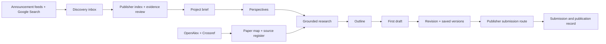

# Architecture

LexRadar connects publication discovery, research, drafting, and submission tracking. Projects, attachments, research-stage history and source registers are stored locally in IndexedDB. A Node API performs requests with server-only credentials.

## Repository structure

| Path | Responsibility |
| --- | --- |
| `src/App.tsx` | Navigation, document workbench, publisher directory, tasks, versions, backups |
| `src/ResearchLab.tsx` | Four-stage research pipeline, stage history, draft acceptance |
| `src/PaperExplorer.tsx` | Scholarly search, paper map, inspector, saving references |
| `src/Discovery.tsx` | Announcement feed, global call search, source register |
| `src/ToolsHub.tsx` | External-tool workspace, transferable brief, direct-open fallback |
| `src/Studio.tsx` | Outline, draft, revision, and completeness assistance |
| `src/Connection.tsx` | Workspace code and connection status |
| `src/model.ts` | Validated local data model and compatible backup defaults |
| `src/documents.ts` | DOCX extraction and export, loaded on demand |
| `server/service.js` | Gemini actions, source fetching, authorization, routing |
| `server/scholarly.js` | OpenAlex/Crossref adapters and graph edges |
| `server/sources.js` | Explicit source register |
| `api/[...path].js` | Vercel Node API entry point |
| `public/discovery-snapshot.json` | Dated starter announcements, separate from live refresh |
| `tests/` | Unit checks and browser workflows |

## Research pipeline

Perspectives ? grounded evidence ? outline ? manuscript. Each stage is a separate request, saved immediately on completion. Full runs stop on a failed or truncated response, or when evidence gathering returns no grounding references. A stage can be rerun with a narrower direction. Accepting a first draft preserves previous working text as a version. Research-stage history is included in project backups. No source becomes verified merely because it was retrieved.

## Reference map method

Shared-reference edges count the intersection of two returned papers' reference lists (bibliographic coupling). Direct-citation edges connect returned papers that cite one another. Node size reflects citation count; positions are ordered by year. At most 24 works are returned per search. Missing reference metadata means missing edges. This is an independent method, not Connected Papers' proprietary model.

## API

| Endpoint | Access | Purpose |
| --- | --- | --- |
| `GET /api/status` | Public | Configuration booleans and source register; never secret values |
| `GET /api/discover?source=...` | Public | Bounded registered-source fetch |
| `GET /api/scholarly?q=...&provider=...&mode=...` | Public | Scholarly metadata and reference edges |
| `POST /api/assist` | Workspace code | Research, writing, and grounded global calls |

Announcement fetches are allowlisted by origin, bounded in time/size, and checked against robots rules. Scholarly requests use fixed providers and bounded result counts. AI requests require the workspace code and reject cross-origin browser requests. Credentials remain server-side. Per-instance short-lived caches are not a shared database or a scheduled monitor.

## External tools

Workspace launchers cover AuraPraxis / AI Studio, the writing editor, Stanford STORM, Connected Papers and Research-Tool. Frames are sandboxed and optional. A direct-open button is always present because provider login and framing restrictions are outside LexRadar's control. Browser frame-load events do not reliably establish successful sign-in. Project text transfers when a user copies and pastes the brief.

## Scaling boundary

This release is a personal workbench with public discovery. General multi-user AI access requires account ownership, persistent quotas, shared discovery storage, a scheduler, and private file storage. These are proposed milestones in [ROADMAP.md](ROADMAP.md), not features claimed by this release.
